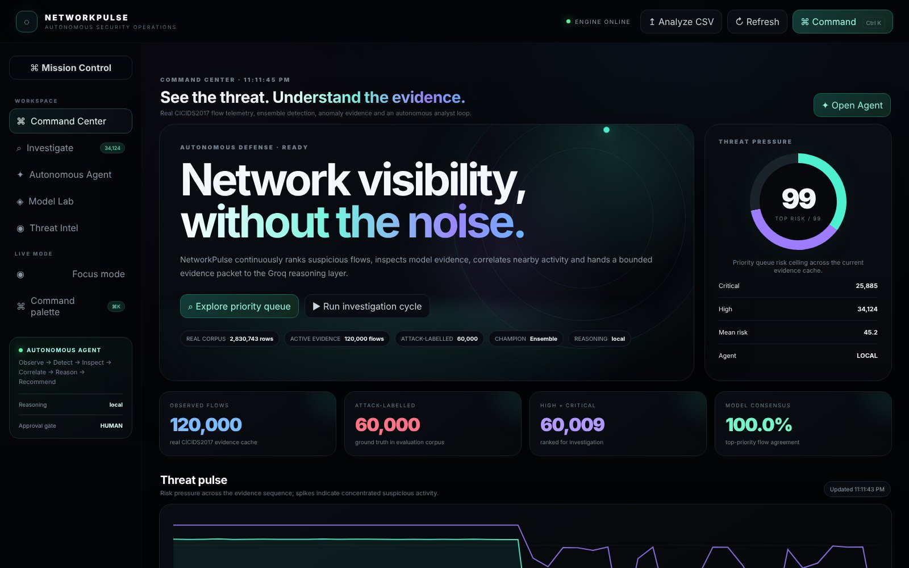
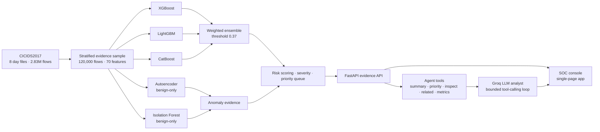
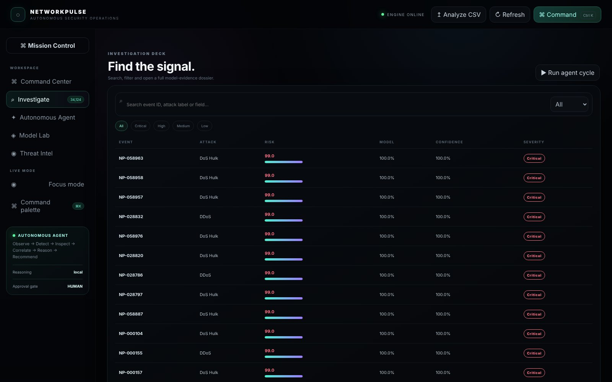
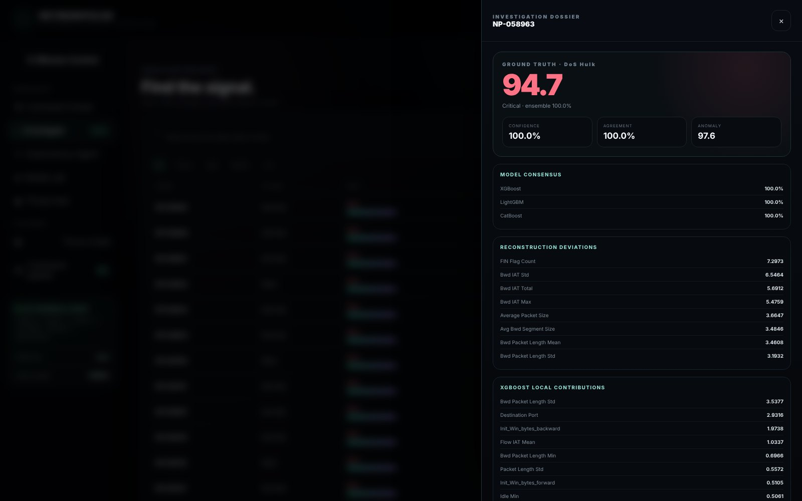
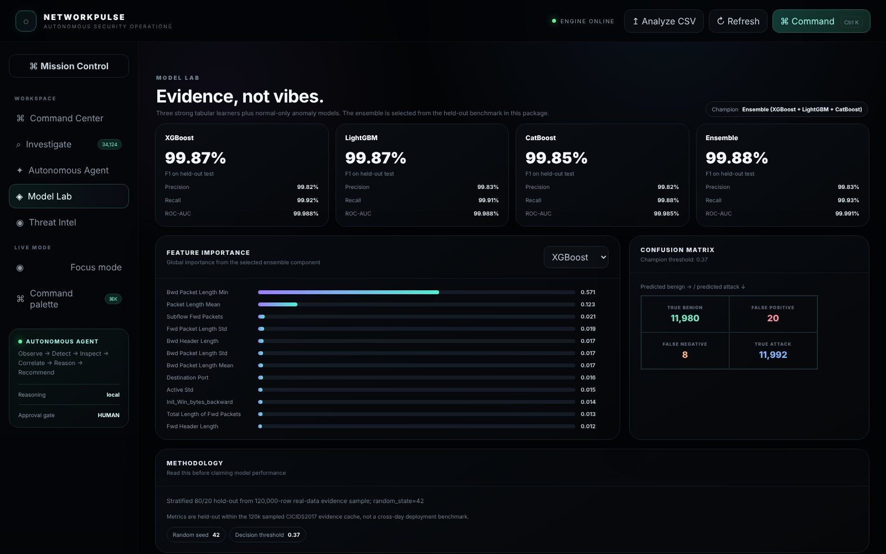
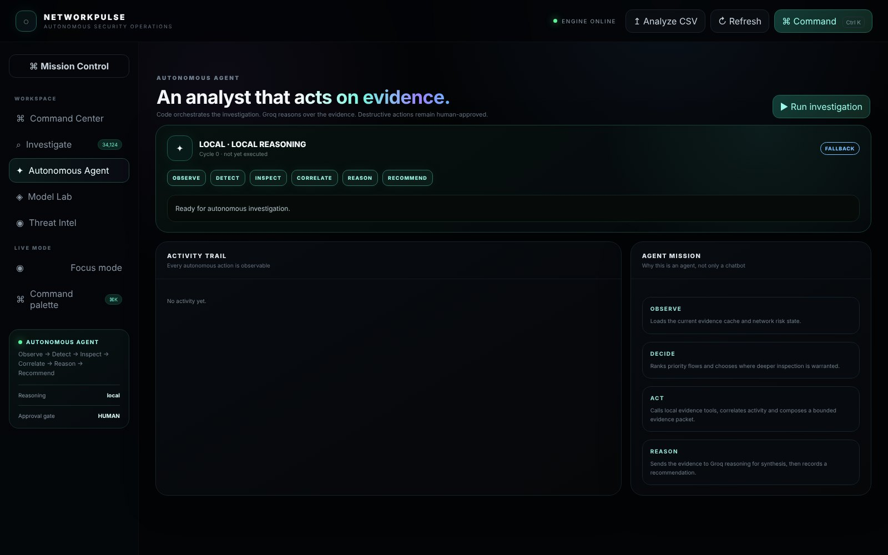

<div align="center">

# NetworkPulse AI

### An evidence-first autonomous SOC console for network intrusion detection

Gradient-boosted ensemble detection · normal-only anomaly evidence · a bounded, tool-calling LLM analyst


[](https://github.com/saisiddhanthks/NetworkPulse-AI/actions/workflows/ci.yml)



</div>

---

## Why this project

Intrusion-detection models are usually shown as a confusion matrix. That is not what an analyst needs. An analyst needs to know which flow to look at first, why the model flagged it, whether independent signals agree, and what to do next.

NetworkPulse AI combines a supervised detector with independent anomaly evidence. It ranks flows by risk and runs an autonomous agent that inspects the evidence through tools before it reasons. The LLM never invents network facts: it only works from the evidence packet the application hands it.

## Highlights

- **Real data.** All 8 CICIDS2017 day files (**2,830,743 flows**, 15 traffic classes). Models are built on a **120,000-flow** stratified evidence sample.
- **Supervised ensemble.** `0.5 × XGBoost + 0.3 × LightGBM + 0.2 × CatBoost`, with the decision threshold (0.37) tuned for F1.
- **Independent anomaly signals.** An **Autoencoder** and an **Isolation Forest** trained on benign traffic only. Their scores feed a risk score alongside the ensemble.
- **Explainability.** Each flow's dossier shows the per-model votes, local XGBoost feature contributions, the largest reconstruction deviations, related flows and raw telemetry.
- **Autonomous agent.** The loop is **Observe → Detect → Inspect → Correlate → Reason → Recommend**, using Groq tool calling. Tools run inside the application and are capped per cycle, and a final synthesis is always produced.
- **Analyst console.** Command Center, Investigation Deck, Model Lab, Autonomous Agent workspace, Threat Intel, command palette (`Ctrl+K`), CSV upload for new traffic, and HTML investigation reports.
- **No build step.** A dependency-free single-page frontend is served directly by FastAPI.

## Architecture



## Results

The evaluation is a held-out test set of **24,000 flows**, a stratified 80/20 split of the 120,000-flow sample (`random_state=42`).

| Model | F1 | Precision | Recall | ROC-AUC |
|---|---:|---:|---:|---:|
| XGBoost | 99.87% | 99.82% | 99.93% | 99.988% |
| LightGBM | 99.87% | 99.83% | 99.91% | 99.988% |
| CatBoost | 99.85% | 99.82% | 99.88% | 99.985% |
| **Ensemble (champion)** | **99.88%** | **99.83%** | **99.93%** | **99.991%** |

> **How to read these numbers.** This is a within-sample split, so training and test flows come from the same capture days. It is **not** a cross-day or cross-network benchmark, and CICIDS2017 is known to be easy for tree models under random splits. The metrics show the components work correctly. They are not a promise of deployment performance. The [`research/`](research/) notebook adds a single-day comparison of nine supervised and unsupervised methods. See [`MODEL_CARD.md`](MODEL_CARD.md) for scope and limitations.

## Screenshots

| Investigation Deck | Event Dossier |
|---|---|
|  |  |
| **Model Lab** | **Autonomous Agent** |
|  |  |

## Quick start

The repository includes the trained models and the evidence cache, so the app runs without retraining.

**Windows**
```bat
start.bat
```

**macOS / Linux**
```bash
./start.sh
```

Then open **http://127.0.0.1:8000/**.

**Enable the LLM analyst (optional).** Copy `backend/.env.example` to `backend/.env` and set `GROQ_API_KEY`. Without a key, the agent runs in local evidence-synthesis mode and every other feature still works. VirusTotal and AbuseIPDB keys are optional and only used for IP enrichment.

**Run the tests**
```bash
cd backend
python tests/smoke_test.py        # every API endpoint
python tests/agent_mock_test.py   # agent tool-calling loop with a mocked LLM
```

**Retrain from the raw corpus (optional).** Download the *MachineLearningCSV* files from the [CIC CICIDS2017 page](https://www.unb.ca/cic/datasets/ids-2017.html) and place them in `backend/data/raw/extracted/`. Then run `scripts\retrain_real_data.bat`, or `python backend/train.py`.

## API

| Endpoint | Purpose |
|---|---|
| `GET /api/health` | Engine, model and LLM configuration state |
| `GET /api/dashboard` | Dashboard payload: summary, risk series, attack mix, events |
| `GET /api/events` | Priority queue with severity, label and text filters |
| `GET /api/events/{id}` | Full evidence dossier for one flow |
| `GET /api/evaluation` | Held-out benchmark |
| `GET /api/models/{model}/importance` | Global feature importance |
| `POST /api/agent/run` | Run one bounded autonomous investigation cycle |
| `POST /api/agent/chat` | Evidence-grounded analyst chat |
| `POST /api/analyze/upload` | Score a new CICIDS-format CSV |
| `GET /api/intel/ip/{ip}` | Optional VirusTotal / AbuseIPDB enrichment |
| `GET /api/report/{id}` | Printable investigation report |

## Repository structure

```
NetworkPulse-AI/
├── backend/
│   ├── app/
│   │   ├── main.py          # FastAPI app and routes
│   │   ├── ml.py            # ensemble + anomaly detector, explanations
│   │   ├── agent.py         # autonomous agent loop and Groq tool calling
│   │   └── config.py
│   ├── models/              # trained XGBoost / LightGBM / CatBoost / anomaly bundles
│   ├── data/                # evidence cache, evaluation, feature importance, manifest
│   ├── tests/               # API smoke test + mocked agent test
│   └── train.py             # retraining pipeline
├── frontend/                # dependency-free SOC console (HTML/CSS/JS)
├── research/                # single-day multi-model research notebook
├── scripts/                 # Windows setup, doctor, data preparation
├── docs/                # screenshots and the IEEE-format paper
├── MODEL_CARD.md
├── LICENSE
└── start.bat · start.sh
```

## Design decisions

- **Why tree boosting.** CICIDS features are tabular flow statistics, where gradient-boosted trees are strong, fast and easy to interpret. Three different implementations average out each model's quirks.
- **Why separate anomaly models.** Labels only exist in the evaluation corpus. Models trained only on benign traffic give a signal that does not depend on attack labels, which is closer to what a deployed system would have.
- **Why a bounded agent.** The application owns tool execution and caps the number of calls. The LLM receives a curated evidence packet and is instructed to separate ground truth from model output. Nothing is ever taken automatically: recommendations go through a human approval gate.

## Limitations

- The benchmark is not cross-day or cross-network, so expect lower performance on traffic from a different environment.
- CICIDS2017 is a lab-generated corpus with known labelling artefacts.
- The agent prioritises and explains. It does not block traffic.

## Paper

An IEEE-format write-up of the system and its evaluation: [`docs/NetworkPulse_AI_IEEE_Paper.pdf`](docs/NetworkPulse_AI_IEEE_Paper.pdf).

## Acknowledgements

- Dataset: I. Sharafaldin, A. H. Lashkari, A. A. Ghorbani, *Toward Generating a New Intrusion Detection Dataset and Intrusion Traffic Characterization*, ICISSP 2018. Canadian Institute for Cybersecurity, University of New Brunswick.
- Built as the Computer Networks course project at VIT Vellore.

---

<div align="center">
<b>Sai Siddhanth</b> · B.Tech CSE (Data Science), VIT Vellore<br/>
<a href="https://www.linkedin.com/in/sai-siddhanth-67912628b">LinkedIn</a> · <a href="https://github.com/saisiddhanthks">GitHub</a>
</div>
